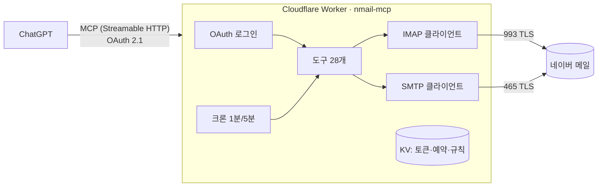

<div align="center">

# 📮 nmail-mcp

**네이버 메일을 ChatGPT에 연결하는 MCP 서버**

읽기 · 검색 · 답장 · 전달 · 정리 · 예약 발송까지, 대화로 네이버 메일을 다룹니다.


</div>

> 네이버의 공식 서비스가 아닙니다. 네이버 메일이 제공하는 IMAP/SMTP로 동작하며, 내 Cloudflare 계정에 직접 배포해 **나 혼자** 쓰는 서버입니다.

---

## 이런 걸 할 수 있어요

| ChatGPT에게 | 서버가 하는 일 |
|---|---|
| "이번 주에 온 결제 메일 정리해줘" | `search_emails` (`결제 newer_than:7d`) → `read_email` |
| "김민수랑 주고받은 메일 흐름 요약해줘" | `find_contacts` → `get_thread` |
| "이 메일에 내일 회의 가능하다고 답장해줘" | `reply_email` (확인 후 발송) |
| "프로모션 메일 다 읽음 처리해줘" | `bulk_action` (개수 먼저 확인 → 실행) |
| "이 뉴스레터 수신거부해줘" | `unsubscribe` (원클릭 / mailto) |
| "월요일 오전 9시에 이 메일 보내줘" | `schedule_email` |
| "다음 주 휴가 동안 부재중 응답 켜줘" | `set_vacation` |

---

## 빠른 시작

### 1. 네이버 준비 (약 3분)

1. **2단계 인증 켜기**: 네이버 ID → 보안설정 → 2단계 인증
2. **애플리케이션 비밀번호 만들기**: 2단계 인증 → 관리 → 애플리케이션 비밀번호 → 생성 (창을 닫으면 다시 볼 수 없으니 복사해 두기)
3. **IMAP 켜기**: 네이버 메일 → 환경설정 → POP3/IMAP 설정 → **IMAP/SMTP 사용: 사용함**

### 2. Cloudflare에 배포

```bash
git clone https://github.com/yakisoba0728/nmail-mcp && cd nmail-mcp
npm install
npx wrangler login

npx wrangler secret put NAVER_ID            # 네이버 아이디 (@naver.com 없이)
npx wrangler secret put NAVER_APP_PASSWORD  # 애플리케이션 비밀번호
npx wrangler secret put NAVER_NAME          # (선택) 보내는 사람 이름
npx wrangler secret put NAVER_SIGNATURE     # (선택) 서명, 줄바꿈은 \n

npm run deploy
```

배포가 끝나면 `https://nmail-mcp.<계정>.workers.dev` 주소가 나옵니다. KV 저장소(`OAUTH_KV`)와 크론은 첫 배포 때 함께 만들어집니다.

<details>
<summary>KV가 자동으로 만들어지지 않을 때</summary>

```bash
npx wrangler kv namespace create OAUTH_KV
```

나온 id를 `wrangler.jsonc`의 `kv_namespaces`에 `"id": "..."`로 넣고 다시 배포합니다.
</details>

### 3. ChatGPT에 연결

1. ChatGPT 설정에서 **개발자 모드**를 켭니다 (유료 요금제 필요, 메뉴 이름은 바뀔 수 있음).
2. 커스텀 커넥터(앱)를 추가합니다.
   - **MCP 서버 URL**: `https://nmail-mcp.<계정>.workers.dev/mcp`
   - **인증**: OAuth (Client ID는 비워 둠, 자동 등록 지원)
3. 뜨는 로그인 화면에 **애플리케이션 비밀번호**를 넣습니다.
4. 첫 대화로 "내 메일함 목록 보여줘"를 해 보세요.

> Claude, Claude Code 등 원격 MCP를 지원하는 다른 클라이언트도 같은 주소로 연결됩니다.

---

## 도구 28개

<details open>
<summary><b>📥 찾기·읽기</b></summary>

| 도구 | 설명 |
|---|---|
| `search_emails` | Gmail식 검색어 + 필드 검색, 전체 메일함, 본문 키워드 검색, 이어서 검색(`resume`) |
| `read_email` | 본문·첨부 목록·링크·SPF/DKIM/DMARC·수신거부 정보·일정 초대. 원문(.eml)·헤더 보기 |
| `get_thread` | 받은·보낸 메일을 한 대화로 묶어 시간순으로 |
| `get_attachment` | 이미지는 ChatGPT가 직접 볼 수 있게, 텍스트는 텍스트로, 나머지는 파일로 |
| `find_contacts` | "김민수한테 보내줘" → 주고받은 메일에서 주소 찾기 |
| `sender_stats` | 많이 보내는 사람 순위 (정리·수신거부 대상 찾기) |
</details>

<details>
<summary><b>📤 보내기</b></summary>

| 도구 | 설명 |
|---|---|
| `send_email` | 참조·숨은참조, HTML, 첨부, 본문 삽입 이미지, 회신 주소, 중요도, 수신확인 요청, 서명 |
| `reply_email` | 원문 인용 + 대화 연결 헤더, 전체 답장, 임시저장으로(`asDraft`) |
| `forward_email` | 원래 첨부 포함 전달, 임시저장으로(`asDraft`) |
| `respond_to_invite` | 일정 초대 수락·거절·미정 회신 (iCalendar REPLY) |
| `unsubscribe` | 원클릭 수신거부(RFC 8058) → mailto → 둘 다 없으면 링크 안내 |
</details>

<details>
<summary><b>📝 임시보관함</b></summary>

| 도구 | 설명 |
|---|---|
| `save_draft` / `list_drafts` | 저장, 목록 |
| `update_draft` | 일부 필드만 고치기 (첨부·대화 헤더 유지) |
| `send_draft` | 바로 보내고 임시보관함에서 제거 |
</details>

<details>
<summary><b>🗂️ 정리</b></summary>

| 도구 | 설명 |
|---|---|
| `move_emails` | 메일함 이동 (`spam` = 스팸 신고, `inbox` = 복원) |
| `set_flags` | 읽음·별표·답장함 표시 |
| `delete_emails` | 휴지통으로, 또는 영구 삭제 |
| `bulk_action` | 검색 결과 전체에 적용 (개수 확인 후 실행, 영구 삭제 없음) |
| `manage_folder` | 메일함 만들기·이름 바꾸기·삭제 |
| `list_folders` / `get_profile` | 메일함 목록·개수, 계정·용량 |
</details>

<details>
<summary><b>⏰ 자동화 (서버 크론)</b></summary>

| 도구 | 설명 |
|---|---|
| `schedule_email` / `cancel_scheduled` | 예약 발송 (시각에 시간대가 없으면 한국 시간) |
| `create_rule` / `delete_rule` | 새 메일 자동 분류: 읽음·별표·이동·휴지통 |
| `set_vacation` | 부재중 자동 응답 (종료일 필수, 같은 사람에게 N일에 한 번) |
| `list_automations` | 켜져 있는 자동화 한눈에 보기 |
</details>

### 검색어

`search_emails`의 `query`는 Gmail 문법을 따르고, 개별 필드와 AND로 합쳐집니다.

```text
결제 "카드 승인" -광고          낱말 · 구문 · 제외
from:shop@x.com -from:spam     보낸 사람 (제외 가능)
to: cc: bcc: subject:          받는 사람 · 제목
after:2026/11/01 before:...    날짜 (한국 시간)
newer_than:7d older_than:1y    상대 기간 (d w m y)
is:unread is:starred is:answered
has:attachment filename:pdf    첨부 (-has:attachment 가능)
larger:5M smaller:100K         크기
in:sent in:anywhere            메일함
```

`OR`, `category:` 같은 지원하지 않는 연산자는 무시하지 않고 `warnings`로 알려 줍니다.

---

## 동작 방식



- **IMAP/SMTP 클라이언트를 직접 구현**했습니다. imapflow는 로그인 한 번에 CPU 7~20ms를 써서 무료 요금제(요청당 10ms)에 맞지 않았고, nodemailer의 SMTP 전송은 Workers 런타임에서 연결되지 않았습니다.
- **필요한 부분만 받습니다.** 메일을 읽을 때 전체 원문이 아니라 본문 파트만 받고, 첨부는 구조 정보로 목록만 만듭니다.
- **한국 메일 인코딩**: EUC-KR, `ks_c_5601-1987`, `cp949`, RFC 2047/2231 한글 파일명, 한글 메일함 이름(수정 UTF-7)을 처리합니다.

<details>
<summary><b>네이버 IMAP의 특이점 (실측)</b></summary>

| 현상 | 대응 |
|---|---|
| BODY/TEXT 검색이 항상 0건 | 제목·보낸 사람은 서버 검색, 본문은 메일 앞부분을 받아 직접 비교 (예산: 기본 25통, 다 못 보면 `complete: false` + `resume`) |
| HEADER 검색이 Message-ID에만 동작 (References·In-Reply-To는 0건) | 대화 묶기를 "Message-ID 조회 + 같은 제목 검색 + 헤더로 연결 확인"으로 구성 |
| OR + HEADER 조합이 0건 | 헤더 검색은 하나씩 따로 보냄 |
| UID가 계정 전체에서 공유되고 UIDNEXT가 실제보다 작음 | 새 메일 감시 기준을 실제 최대 UID로 |
| SMTP로 보낸 메일이 보낸메일함에 저장되지 않음 | 발송 후 직접 보낸메일함에 저장 |
| SORT·THREAD 확장 없음 | 날짜 정렬·대화 묶기를 서버에서 처리 |
</details>

---

## 요금제와 성능

Workers **무료 요금제는 요청당 CPU 10ms**입니다 (가끔 넘는 것은 봐주지만 계속 넘으면 요청을 중단). 무료에 최대한 맞추도록 최적화했지만, **메일 한 통을 다루는 작업만 대체로 들어가고 검색·통계는 넘을 가능성이 높습니다.** 자주 쓴다면 Workers Paid($5/월, 요청당 CPU 기본 30초)를 권합니다.

<details>
<summary><b>도구별 CPU 측정 (로컬 추정치)</b></summary>

`npm run bench`로 로컬 Node에서 잰 값입니다 (ms, 2026-11-24). **Cloudflare에서 실측한 값이 아닙니다.**

- **첫 호출**: 처음 실행(JIT 전). 혼자 가끔 쓰는 서버는 새 격리(cold)에서 도는 일이 많아 이 값에 가깝습니다.
- **최소·중앙값**: 같은 프로세스에서 반복(warm).
- Node 수치에는 workerd가 네이티브로 하는 TLS(연결당 3~5ms)가 들어 있어 크게 나올 수 있고, 반대로 workerd에서 JS가 더 느릴 수도 있어 어느 쪽으로든 단정할 수 없습니다.

| 도구 | 최적화 전 (중앙값) | 첫 호출 | 최소 | 중앙값 | 10ms 안에 들 가능성 |
|---|---:|---:|---:|---:|---|
| `tools/list` | 9.4 | 18.5 | 0.8 | 1.4 | warm이면 높음, cold면 넘음 |
| `list_drafts` | 9.9 | 4.8 | 4.0 | 4.7 | 높음 |
| `read_email` (작은 메일) | 15.0 | 7.6 | 4.9 | 6.0 | 높음 |
| `read_email` (큰 HTML) | 16.1 | 6.5 | 6.4 | 6.8 | 높음 |
| `get_profile` | 15.3 | 21.1 | 4.6 | 6.2 | warm이면 높음, cold면 넘음 |
| 받은메일함 검색 | 16.1 | 9.0 | 7.8 | 8.7 | 경계 |
| `list_folders` | 20.7 | 12.2 | 9.9 | 11.4 | 경계 |
| `get_thread` | 28.2 | 16.8 | 14.4 | 14.9 | 넘을 가능성 높음 |
| `subject:` 검색 (전체 메일함) | 25.5 | 14.8 | 14.4 | 16.4 | 넘을 가능성 높음 |
| 전체 메일함 검색 | 66.8 | 20.2 | 16.7 | 18.7 | 넘을 가능성 높음 |
| 받은메일함 검색 + 미리보기 | 52.4 | 31.1 | 16.7 | 20.0 | 넘을 가능성 높음 |
| 본문 키워드 검색 (25통) | 210.8 | 30.7 | 30.6 | 30.7 | 넘음 |
| `sender_stats` (150통) | 463.3 | 39.9 | 39.9 | 42.6 | 넘음 |

보내는 쪽 (메일 만들기만, 네트워크 제외, 최소): 텍스트 1.3 · 첨부 100KB 3.1 · 1MB 5.7 · 5MB 11.7. 여기에 SMTP 접속과 보낸메일함 저장이 더해지므로 **큰 첨부 발송은 10ms를 넘을 가능성이 높습니다.**

적용한 최적화:

- IMAP 클라이언트 직접 구현, 번들 3.5MB → 2.0MB
- 도구 스키마를 시작 단계(요청 CPU에 안 잡힘)에서 한 번만 변환
- 읽기는 필요한 파트만, 여러 메일함 검색은 날짜만 받아 정렬 후 결과 페이지만 상세 조회
- 본문 검색 기본 25통·통당 앞 6KB, 통계·연락처 기본 150통, 미리보기는 요청할 때만
- 메일함 목록 5분 캐시

**배포 후 실제 확인**: `npx wrangler tail`에서 `Exceeded CPU Limit`이 나오는지 보고, 요청별 CPU 시간은 Cloudflare 대시보드의 Workers 지표에서 확인합니다.
</details>

---

## 보안과 개인정보

- **비밀번호는 Worker 시크릿에만** 있습니다. KV에는 OAuth 토큰과 자동화 상태(예약 메일 원문은 보낸 뒤 삭제, 분류 규칙, 부재중 설정, 30일 응답 기록, 새 메일 감시 위치)만 저장합니다.
- **로그인 화면**은 권한이 전달될 곳을 보여 주고, ChatGPT·Claude가 아니면 경고합니다. 시도는 IP당 분당 5회로 제한합니다.
- **메일 본문은 신뢰할 수 없는 데이터입니다.** 메일 속 지시문에 속은 AI가 메일을 보내거나 지우지 않도록, 발송·삭제 도구 설명은 AI에게 먼저 사용자 확인을 받으라고 지시합니다. 서버가 강제하는 것은 아니므로 ChatGPT의 쓰기 도구 확인도 켜 두기를 권합니다.
- **자동 전달 규칙은 일부러 없습니다.** 속은 AI가 전달 규칙을 만들면 메일이 계속 밖으로 새기 때문입니다.
- **일괄 처리**는 먼저 개수를 확인(`dryRun`)하고, 실행할 때 개수가 달라졌으면 서버가 거부합니다. 영구 삭제는 일괄 처리에 없습니다.
- **부재중 응답**은 RFC 3834를 따라 메일링 리스트·no-reply·자동응답·내 주소에는 답하지 않습니다.
- **연결 끊기**: 네이버에서 애플리케이션 비밀번호를 삭제하면 즉시 끊깁니다. 새로 만들었다면 `npx wrangler secret put NAVER_APP_PASSWORD`로 교체합니다.

---

## 개발

```bash
npm install
cp .dev.vars.example .dev.vars    # NAVER_ID, NAVER_APP_PASSWORD 채우기
npm run dev                       # http://localhost:8787/mcp (크론 시험 --test-scheduled 포함)
```

| 명령 | 내용 |
|---|---|
| `npm test` | 단위 테스트 (IMAP 파서·명령 생성, 검색어, 인코딩, 일정, SMTP) |
| `npm run typecheck` | 타입 검사 |
| `npm run e2e` | 실제 계정 종합 시험 75항목. 내 주소로만 보내고 끝나면 모두 영구 삭제 (`npm run dev` 실행 중이어야 함) |
| `npm run bench` | 도구별 CPU 측정 (`ONLY=<정규식>`으로 골라 실행) |
| `node test/client.mjs call <도구> '<json>'` | 도구 하나 직접 호출 |

<details>
<summary><b>코드 구조</b></summary>

| 파일 | 역할 |
|---|---|
| `src/index.ts` | Worker 진입점: OAuth 래핑, 크론 |
| `src/auth.ts` | 로그인(동의) 화면, 비밀번호 확인, 시도 제한 |
| `src/tools.ts` | MCP 도구 정의 (모듈 로드 때 한 번 생성, JSON Schema 미리 변환) |
| `src/imap.ts` | IMAP 클라이언트: 응답 토크나이저, ENVELOPE/BODYSTRUCTURE 해석, 수정 UTF-7 |
| `src/smtp.ts` | SMTP 클라이언트 (465, AUTH PLAIN) |
| `src/mime.ts` | 문자셋·인코딩 단어·전송 인코딩, HTML→텍스트, 첨부 구분, .ics |
| `src/mail.ts` | 계정, IMAP 세션, 메일함 (별칭·역할·캐시), 프로필 |
| `src/read.ts` | 읽기 (필요한 부분만), 첨부 받기 |
| `src/send.ts` | 작성·발송, 답장·전달, 임시보관함, 일정 회신, 수신거부 |
| `src/organize.ts` | 이동·표시·삭제 (여러 메일함에 걸쳐) |
| `src/search.ts` | 검색어 해석, 검색 엔진 (본문 스캔 예산), 대화 묶기, 통계·연락처 |
| `src/automation.ts` | 예약 발송, 분류 규칙, 부재중 응답 (크론) |
</details>

---

## 알려진 한계

- **무료 요금제**에서 검색·대화 묶기·통계·큰 첨부 발송은 CPU 10ms를 자주 넘을 것으로 보입니다 (로컬 추정, 실측 전).
- **대화 묶기**: 원래 메일에서 시작하면, 제목이 바뀐 답장은 찾지 못할 수 있습니다 (답장 쪽에서 시작하면 원래 메일을 찾습니다). 네이버가 References 검색을 지원하지 않기 때문입니다.
- **본문 검색**은 메일 앞부분(6KB, HTML은 18KB)만 봅니다.
- **크론 중복**: KV는 잠금이 아니어서, 크론 실행이 겹치는 드문 경우 예약 메일이 두 번 나갈 수 있습니다.
- **로그인 빈도**: 분류 규칙이나 부재중 응답이 켜져 있으면 5분마다 IMAP에 로그인합니다. 짧은 시간에 로그인이 많으면 네이버가 잠시 연결을 늦추는 것으로 보입니다 (연결 오류는 한 번 자동 재시도).
- **아직 확인하지 못한 것**: Cloudflare에 배포된 상태에서의 동작, 실제 ChatGPT 연결, 다른 계정에서 온 메일에 대한 부재중 응답 발송, 원클릭 수신거부.
