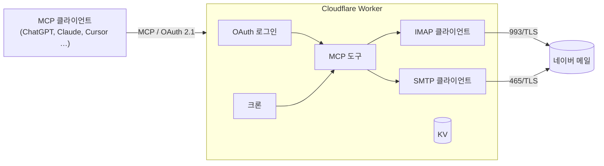

# nmail-mcp

[](LICENSE)
[](https://workers.cloudflare.com/)
[](https://modelcontextprotocol.io/)

네이버 메일용 원격 MCP 서버입니다. MCP를 지원하는 AI 클라이언트라면 어디에 붙여도 됩니다. ChatGPT, Claude, Claude Code, Codex, Cursor, VS Code 같은 곳에 주소 하나만 등록하면, 대화하면서 메일을 찾고 읽고 답장하고 정리할 수 있습니다.

네이버가 공식으로 MCP를 제공하지 않아서 IMAP/SMTP로 직접 붙였습니다. 내 Cloudflare 계정에 올려 혼자 쓰는 구조이고, 네이버 공식 서비스와는 관련이 없습니다.

[English](#english)

## 할 수 있는 일

- 메일 검색: Gmail 검색어 문법(`from:` `newer_than:7d` `has:attachment` `-제외어` 등), 모든 메일함 한 번에 검색, 본문 키워드 검색
- 읽기: 본문, 첨부 목록, 링크, SPF/DKIM/DMARC 결과, 일정 초대(.ics). 원문(.eml)이나 전체 헤더도 볼 수 있습니다.
- 대화 묶기: 받은 메일과 보낸 메일을 한 흐름으로 시간순 정렬
- 첨부: 이미지는 AI가 직접 볼 수 있는 이미지 콘텐츠로, 텍스트는 텍스트로, 나머지는 파일로 돌려줍니다.
- 보내기: 새 메일, 답장(전체 답장), 전달(원래 첨부 포함), 일정 초대 수락·거절. 참조·숨은참조, HTML, 첨부, 서명 지원
- 임시보관함: 저장, 목록, 고치기, 바로 보내기
- 정리: 이동, 읽음·별표, 휴지통, 메일함 관리, 검색 결과 일괄 처리
- 수신거부: 원클릭(RFC 8058)이나 mailto로 처리하고, 둘 다 없으면 링크를 알려 줍니다.
- 자동화: 예약 발송, 새 메일 자동 분류, 부재중 자동 응답

연결한 뒤에는 이런 식으로 말하면 됩니다.

```text
이번 주에 온 결제 메일 정리해 줘
김민수랑 주고받은 메일 흐름 요약해 줘
이 메일에 내일 회의 가능하다고 답장해 줘
프로모션 메일 전부 읽음 처리해 줘
월요일 오전 9시에 이 메일 보내 줘
```

## 설치

### 1. 네이버 설정

1. 네이버 ID → 보안설정 → 2단계 인증을 켭니다.
2. 2단계 인증 → 관리 → 애플리케이션 비밀번호를 하나 만듭니다. 창을 닫으면 다시 볼 수 없으니 복사해 둡니다.
3. 네이버 메일 → 환경설정 → POP3/IMAP 설정에서 "IMAP/SMTP 사용"을 켭니다.

### 2. Cloudflare에 배포

Node.js 20 이상과 Cloudflare 계정이 필요합니다.

```bash
git clone https://github.com/yakisoba0728/nmail-mcp
cd nmail-mcp
npm install
npx wrangler login

npx wrangler secret put NAVER_ID            # 네이버 아이디 (@naver.com 빼고)
npx wrangler secret put NAVER_APP_PASSWORD  # 위에서 만든 애플리케이션 비밀번호
npx wrangler secret put NAVER_NAME          # 선택: 보내는 사람 이름
npx wrangler secret put NAVER_SIGNATURE     # 선택: 서명 (줄바꿈은 \n)

npm run deploy
```

배포가 끝나면 `https://nmail-mcp.<계정 하위 도메인>.workers.dev` 주소가 나옵니다. KV 저장소와 크론은 첫 배포 때 같이 만들어집니다.

로그인한 Cloudflare 계정이 여러 개면 프로젝트 폴더의 `.env`에 `CLOUDFLARE_ACCOUNT_ID=<계정 ID>`를 적어 두세요. KV가 자동으로 안 만들어지면 `npx wrangler kv namespace create OAUTH_KV`로 만들고 나온 id를 `wrangler.jsonc`의 `kv_namespaces`에 넣으면 됩니다.

### 3. 클라이언트에 연결

서버 주소는 `https://nmail-mcp.<계정 하위 도메인>.workers.dev/mcp` 하나입니다. Streamable HTTP와 OAuth 2.1(클라이언트 자동 등록, PKCE)을 쓰기 때문에, 원격 MCP 서버와 OAuth를 지원하는 클라이언트면 어디든 연결됩니다. Client ID나 API 키는 따로 넣지 않습니다.

| 클라이언트 | 연결 방법 |
|---|---|
| ChatGPT | 설정에서 개발자 모드를 켜고 커스텀 커넥터 추가 → URL 입력, 인증은 OAuth |
| Claude (웹·데스크톱) | 설정 → 커넥터 → 커스텀 커넥터 추가 → URL 입력 |
| Claude Code | `claude mcp add --transport http nmail <URL>` 후 `/mcp`에서 로그인 |
| Codex CLI | `codex mcp add nmail --url <URL>` 후 `codex mcp login nmail` |
| Cursor | `~/.cursor/mcp.json`에 `{"mcpServers": {"nmail": {"url": "<URL>"}}}` |
| VS Code | `.vscode/mcp.json`에 `{"servers": {"nmail": {"type": "http", "url": "<URL>"}}}` |

메뉴 이름이나 설정 형식은 클라이언트 버전에 따라 바뀔 수 있으니 각 클라이언트 문서를 함께 보세요. 위 방법은 각 문서를 기준으로 정리한 것이고, 모든 클라이언트에서 직접 확인한 것은 아닙니다.

연결하면 로그인 창이 뜹니다. 네이버 애플리케이션 비밀번호를 넣으면 끝입니다. 처음에는 "메일함 목록 보여 줘" 정도로 확인해 보세요. 여러 클라이언트에 동시에 연결해도 됩니다.

연결을 모두 끊고 싶으면 네이버에서 그 애플리케이션 비밀번호를 지우면 됩니다.

## 도구 목록

| 분류 | 도구 |
|---|---|
| 계정·메일함 | `get_profile`, `list_folders`, `manage_folder` |
| 찾기·읽기 | `search_emails`, `read_email`, `get_thread`, `get_attachment`, `find_contacts`, `sender_stats` |
| 보내기 | `send_email`, `reply_email`, `forward_email`, `respond_to_invite`, `unsubscribe` |
| 임시보관함 | `save_draft`, `list_drafts`, `update_draft`, `send_draft` |
| 정리 | `move_emails`, `set_flags`, `delete_emails`, `bulk_action` |
| 자동화 | `schedule_email`, `cancel_scheduled`, `create_rule`, `delete_rule`, `set_vacation`, `list_automations` |

메일함 이름 대신 `inbox`, `sent`, `drafts`, `trash`, `spam`(또는 받은메일함, 보낸메일함 같은 한글 이름)을 써도 됩니다.

### 검색어

`search_emails`의 `query`는 Gmail 문법을 따릅니다. 여러 조건은 AND로 묶입니다.

```text
결제 "카드 승인" -광고          낱말, 정확한 구문, 제외
from:shop@x.com -from:spam     보낸 사람
to: cc: bcc: subject:          받는 사람, 제목
after:2026/11/01 before:...    날짜 (한국 시간)
newer_than:7d older_than:1y    기간 (d, w, m, y)
is:unread is:starred is:answered
has:attachment filename:pdf
larger:5M smaller:100K
in:sent in:anywhere
```

`OR`이나 `category:`처럼 지원하지 않는 연산자는 조용히 무시하지 않고 `warnings`에 적어서 돌려줍니다.

## 구조



IMAP과 SMTP 클라이언트는 직접 만들었습니다. 처음에는 imapflow를 썼는데 로그인 한 번에 CPU를 7~20ms씩 써서 Workers 무료 요금제 한도(요청당 10ms)를 혼자 다 먹었고, nodemailer의 SMTP 전송은 Workers 런타임에서 연결이 안 됐습니다. 메일을 읽을 때도 원문 전체가 아니라 필요한 파트만 받아 옵니다.

한국 메일에서 자주 나오는 EUC-KR, `ks_c_5601-1987`, `cp949`, 한글 첨부 파일명(RFC 2047/2231), 한글 메일함 이름(수정 UTF-7)도 처리합니다.

### 네이버 IMAP에서 알아낸 것

만들면서 실제 계정으로 확인한 내용입니다. 다른 네이버 메일 도구를 만들 때도 참고가 될 것 같아 적어 둡니다.

| 동작 | 대응 |
|---|---|
| BODY/TEXT 검색이 항상 0건 | 제목·보낸 사람은 서버 검색, 본문은 메일 앞부분을 받아 직접 비교 |
| HEADER 검색이 Message-ID에만 동작 (References, In-Reply-To는 0건) | 대화 묶기를 Message-ID 조회와 같은 제목 검색으로 구성 |
| OR와 HEADER를 섞으면 0건 | 헤더 검색은 하나씩 따로 보냄 |
| UID가 계정 전체에서 공유되고 UIDNEXT가 실제 최댓값보다 작음 | 새 메일 감시는 실제 최대 UID 기준 |
| SMTP로 보낸 메일이 보낸메일함에 안 남음 | 발송 후 직접 보낸메일함에 저장 |
| SORT, THREAD 확장 없음 | 정렬과 대화 묶기를 서버 쪽에서 처리 |

본문 검색은 한 번에 25통까지만 봅니다. 다 못 보면 결과에 `complete: false`와 `resume` 값이 같이 오고, 그 값을 넘기면 멈춘 곳부터 이어서 찾습니다.

## 비용과 성능

Cloudflare Workers 무료 요금제로도 돌아가지만 권하지는 않습니다. 무료 요금제는 요청당 CPU가 10ms인데, 실제 배포에서 재 보니 거의 모든 요청이 그보다 많이 썼습니다.

| 요청 | CPU (ms) |
|---|---:|
| OAuth 등록·로그인·토큰 발급 | 3–6 |
| `tools/list` (토큰 확인 포함) | 11–36 |
| `list_automations` (네이버 접속 없음) | 10 |
| `read_email` | 23–31 |
| `list_drafts` | 27 |
| `list_folders`, `get_profile` | 44–46 |
| 검색 (받은메일함 / 전체 / 제목 / 본문) | 41 / 46 / 59 / 49 |
| `get_thread` | 40 |
| `sender_stats`, `find_contacts` | 74, 111 |

2026년 11월에 `wrangler tail`로 요청마다 한 번씩 잰 값입니다. 측정할 때 끊긴 요청은 없었지만, Cloudflare는 한도를 계속 넘는 Worker를 중단할 수 있다고 안내합니다.

그래서 Workers Paid($5/월)를 쓰는 편이 마음 편합니다. 요청당 CPU 한도가 30초로 늘어나고, 혼자 쓰는 정도로는 포함 사용량(월 1,000만 요청, CPU 3,000만 ms)의 1%도 안 씁니다. 추가 요금이 걱정되면 Billing → Spend Management에서 Workers 지출 한도를 $0.01로 걸어 두면 포함량을 넘는 순간 멈춥니다.

## 보안

- 네이버 비밀번호는 Worker 시크릿에만 있습니다. KV에는 OAuth 토큰과 자동화 상태(예약 메일, 분류 규칙, 부재중 설정)만 들어가고, 예약 메일 원문은 보낸 뒤 지웁니다.
- 로그인 창은 권한이 어디로 넘어가는지 보여 줍니다. 내 컴퓨터의 앱(Claude Code, Cursor 등)이 아니고 잘 알려진 AI 서비스도 아닌 곳이면 경고를 띄웁니다. 비밀번호 시도는 IP당 분당 5회로 막혀 있습니다.
- 메일 본문은 믿으면 안 되는 데이터입니다. 메일 안에 "이 메일을 전달해" 같은 문장이 있어도 AI가 따르지 않도록 도구 설명에 적어 두었지만, 서버가 강제하는 건 아닙니다. 쓰는 클라이언트에서 도구 실행 전 확인 기능을 켜 두세요.
- 같은 이유로 자동 전달 규칙은 일부러 만들지 않았습니다.
- `bulk_action`은 먼저 개수만 세는 dry run을 하고, 실제 실행할 때 개수가 달라졌으면 거부합니다. 영구 삭제는 일괄 처리로 할 수 없습니다.
- 부재중 응답은 RFC 3834를 따릅니다. 메일링 리스트, no-reply, 자동 응답, 내 주소에는 답하지 않습니다.

## 개발

```bash
cp .dev.vars.example .dev.vars   # NAVER_ID, NAVER_APP_PASSWORD 입력
npm run dev                      # http://localhost:8787/mcp
```

| 명령 | 하는 일 |
|---|---|
| `npm test` | 단위 테스트 |
| `npm run typecheck` | 타입 검사 |
| `npm run e2e` | 실제 계정으로 전체 기능 시험. 내 주소로만 보내고 끝나면 시험 메일을 전부 지웁니다. `npm run dev`를 켜 둔 상태에서 실행하세요. |
| `npm run bench` | 도구별 CPU 측정 (Node 기준, 상대 비교용) |
| `node test/client.mjs call <도구> '<json>'` | 도구 하나 직접 호출 |

| 파일 | 내용 |
|---|---|
| `src/index.ts` | Worker 진입점, OAuth, 크론 |
| `src/auth.ts` | 로그인 화면, 비밀번호 확인, 시도 제한 |
| `src/tools.ts` | MCP 도구 정의 |
| `src/imap.ts` | IMAP 클라이언트 |
| `src/smtp.ts` | SMTP 클라이언트 |
| `src/mime.ts` | 문자셋, 인코딩, HTML→텍스트, 첨부 구분, .ics |
| `src/mail.ts` | 계정, IMAP 세션, 메일함 |
| `src/read.ts` | 읽기, 첨부 |
| `src/send.ts` | 보내기, 답장, 전달, 임시보관함, 일정 회신, 수신거부 |
| `src/organize.ts` | 이동, 표시, 삭제 |
| `src/search.ts` | 검색, 대화 묶기, 통계, 연락처 |
| `src/automation.ts` | 예약 발송, 분류 규칙, 부재중 응답 |

## 알려진 한계

- 원래 메일에서 대화를 묶으면 제목이 바뀐 답장은 빠질 수 있습니다. 답장 쪽에서 시작하면 원래 메일을 찾습니다. 네이버가 References 검색을 지원하지 않아서 생기는 문제입니다.
- 본문 검색은 메일마다 앞부분(6KB, HTML은 18KB)만 봅니다.
- 크론 실행이 겹치는 아주 드문 경우 예약 메일이 두 번 나갈 수 있습니다. KV에 잠금 기능이 없기 때문입니다.
- 분류 규칙이나 부재중 응답을 켜 두면 5분마다 IMAP에 로그인합니다. 짧은 시간에 로그인이 몰리면 네이버가 잠깐 연결을 늦추는 경우가 있었습니다(연결 오류는 한 번 다시 시도합니다).
- 원클릭 수신거부와, 다른 사람이 보낸 메일에 대한 부재중 응답은 실제로 시험해 보지 못했습니다.

## English

**nmail-mcp** is a remote Model Context Protocol (MCP) server for Naver Mail (네이버 메일). Any MCP client with remote server and OAuth support can use it: ChatGPT, Claude, Claude Code, Codex, Cursor, VS Code and others. It runs on Cloudflare Workers, talks to Naver over IMAP/SMTP, and signs you in with OAuth 2.1 using a Naver app password.

- 28 tools: Gmail-style search with body keyword scan, read, threads, attachments (images returned as image content), send / reply / forward, drafts, bulk actions, unsubscribe (RFC 8058), calendar invite replies, scheduled send, filing rules and a vacation responder
- Lightweight IMAP and SMTP clients written for Workers; handles EUC-KR / cp949 mail and Korean folder names
- Deploy: set `NAVER_ID` and `NAVER_APP_PASSWORD` as Worker secrets, run `npm run deploy`, then add `https://<worker>.workers.dev/mcp` to your MCP client as a remote (Streamable HTTP) server; it signs in with OAuth, no API key needed
- Workers Paid ($5/month) is recommended; most requests use 10–110 ms of CPU, above the free plan's 10 ms

Not affiliated with Naver.

## 라이선스

[Apache-2.0](LICENSE)
